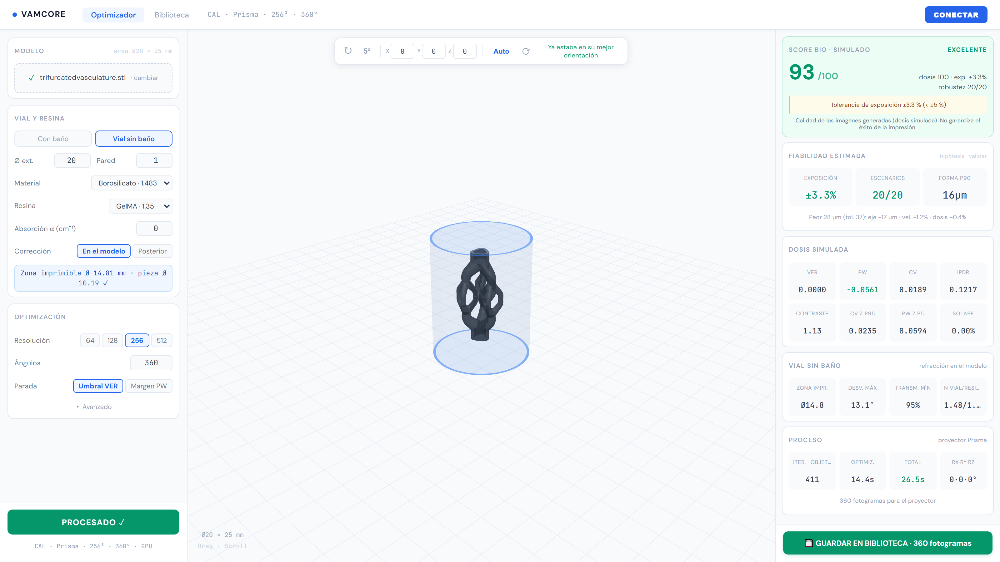

<div align="center">


# VAMCORE

**Impresión volumétrica tomográfica, del modelo 3D a la proyección**



</div>

## Descripción

VAMCORE es un software completo para la **impresión volumétrica tomográfica** (*Volumetric Additive Manufacturing*,
*Computed Axial Lithography*). A partir de un STL calcula la secuencia de imágenes que el projector emite mientras
gira el vial, evalúa la calidad de la impresión simulada y envía la secuencia a la impresora, sincronizada con el
motor de giro.

Su núcleo es **Prisma**, un motor tomográfico propio escrito en PyTorch y acelerado en GPU. Modela la refracción del
vial y la absorción de la resina dentro de la propia optimización, lo que permite imprimir sin baño de *index
matching*. Cada resultado incluye un **Score Bio /100**, que combina la dosis simulada, la tolerancia de exposición y
una prueba de robustez frente a errores de la máquina.

> **Beta.** Los resultados son simulados: el Score Bio mide la calidad de las imágenes generadas y no garantiza el
> éxito de la impresión.

## Funciones principales

- **Motor Prisma:** proyector tomográfico disperso en GPU (o CPU), optimización CAL, voxelizado con ocupación
  parcial y auto-orientación de la pieza.
- **Física del vial y de la resina:** refracción y pérdidas en las paredes del vial, absorción Beer–Lambert.
- **Evaluación:** métricas de dosis, tolerancia de exposición, 20 escenarios de robustez y Score Bio.
- **Interfaz web:** visor 3D, parámetros de vial, resina y optimización, resultados y biblioteca de trabajos.
- **Impresora:** envío de la secuencia por HTTP; el projector la reproduce sincronizada con el giro (Klipper).

## Inicio rápido

```bash
pip install torch --index-url https://download.pytorch.org/whl/cu124   # con GPU NVIDIA; sin GPU: pip install torch
pip install -e ".[app]"
python server.py                     # API local en http://127.0.0.1:8000
cd frontend && npm ci && npm run dev # interfaz en http://localhost:5173
```

También funciona sin interfaz:

```bash
python -m vamcore --example salida/ --res 128 --vial 20 1 --auto-orient
```

## Rendimiento

Medido en una RTX 4060 Ti 16 GB, con la vasculatura de ejemplo, 360 ángulos y el vial dentro del modelo:

| Resolución | Optimización | Proceso completo | Score Bio |
|---|---|---|---|
| 128³ | 1,8 s | 12,2 s | 93/100 |
| 256³ | 14,4 s | 26,5 s | 93/100 |

El proceso completo incluye voxelizado, prueba de robustez y la exportación de 360 fotogramas.

## Documentación

| Documento | Contenido |
|---|---|
| [Referencia técnica](docs/REFERENCIA.md) | Línea de comandos, API de Python, módulos del motor, modelos físicos y API HTTP. |
| [Software del projector](device/README.md) | Proyección, motor de giro, red e instalación en la impresora. |
| [Ejemplos](examples/) | Uso del motor desde Python. |

## Estructura

```text
vamcore/     motor Prisma (paquete de Python)        frontend/   interfaz web
server.py    API local                               device/     software del projector
tests/       97 pruebas                              docs/       documentación técnica
```

## Licencia

[GPL-3.0-or-later](LICENSE). Los módulos derivados de trabajos previos conservan su atribución en la cabecera.
