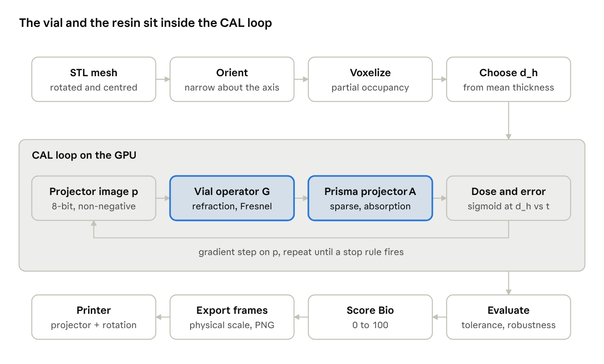

# Prisma: a physics-aware GPU engine for tomographic volumetric printing

*Technical white paper · VAMCORE project · Pedro Rocca · November 2026*

> **Status: theoretical and simulation-only.** Every result in this paper comes from the engine's own forward model. No print tests have been carried out, so nothing here demonstrates that a part prints correctly. Timings were measured on one workstation (NVIDIA RTX 4060 Ti, 16 GB). This is an internal technical description of the VAMCORE project and is not intended for publication.

**Contents:** [Abstract](#abstract) · [1 Introduction](#1-introduction) · [2 Background](#2-background-cal-as-an-inverse-problem) · [3 Architecture](#3-system-architecture) · [4 Prisma projector](#4-the-prisma-projector) · [5 Absorption](#5-resin-absorption) · [6 Vial refraction](#6-in-model-vial-refraction) · [7 Target and metrics](#7-target-partial-occupancy-and-guard-band-metrics) · [8 Stopping](#8-optimization-and-stopping) · [9 Printability](#9-printability-evaluation) · [10 Performance](#10-measured-performance) · [11 Limitations](#11-limitations-and-validation-plan) · [12 Conclusions](#12-conclusions-and-software-availability) · [AI](#acknowledgements-and-use-of-ai) · [References](#references)

## Abstract

Tomographic volumetric printing builds a whole part at once by projecting a computed sequence of light patterns into a rotating vial of photosensitive resin. The quality of that sequence depends on the vial, the resin and the machine, yet these are usually ignored or corrected after the optimization.

We describe Prisma, the engine of the VAMCORE project. It is a computed axial lithography (CAL) optimizer written in PyTorch, built on a parallel-beam projector that stores one sparse Joseph matrix shared by every layer, with a voxel-driven backprojector. Refraction and Fresnel transmission at the vial walls enter the forward model as a linear operator with an exact adjoint. As a result, the optimizer works directly on the image the projector emits. Resin absorption follows Beer–Lambert. Each result is scored with guard-band dose metrics, an exposure tolerance and a 20-scenario robustness test, combined into a Score Bio from 0 to 100.

In simulation, optimizing with the vial inside the model gives 2.5 to 6 times more exposure tolerance than correcting the images afterwards. On a consumer GPU, a 256³ vasculature with 360 angles is optimized in 14.4 s, and the full pipeline takes 26.5 s. A stopping rule based on the process-window margin cuts a 512³ optimization from 37.4 s to 7.9 s. All results are simulated: no prints have been made yet.

## 1 Introduction

Volumetric additive manufacturing (VAM) solidifies a whole object in seconds to minutes. A projector shines a sequence of 2D patterns into a rotating container of resin, and the doses accumulated over a full turn exceed the gelation threshold only inside the target. Computed axial lithography (CAL) frames the choice of patterns as a tomographic inverse problem. The approach is attractive for soft, cell-laden hydrogels, which are hard to print layer by layer.

In practice, three gaps separate a computed sequence from a good print:

- **Speed.** The iterative optimization repeats forward and back projections of the full volume hundreds of times, which limits resolution and the turnaround of each design.
- **The vial.** Without an index-matching bath, the cylindrical vial bends the rays. A common remedy resamples the finished patterns, which leaves the optimizer unaware of the loss and distortion it introduces.
- **What counts as success.** Optimizers usually report the volumetric error alone. That error says nothing about how far the exposure can drift before the part changes shape, or how sensitive the result is to errors in the machine.

This paper describes how Prisma addresses each gap. Its contributions are:

1. A parallel-beam projector that stores a single sparse Joseph matrix shared by all layers. It runs in cuSPARSE with automatically tuned layer blocks and a voxel-driven backprojector that keeps CAL stable at 512³ (Section 4).
2. Resin absorption and vial refraction modelled inside the forward operator, with an exact adjoint, so the optimizer works on the image the projector emits. This includes the column-spacing condition needed for the adjoint to be well behaved (Sections 5–6).
3. Guard-band metrics for targets with partial occupancy, and a stopping rule based on the process-window margin (Sections 7–8).
4. A printability evaluation that combines dose quality, exposure tolerance and a robustness test into one score (Section 9).

Prisma is the engine of VAMCORE, an open-source application (GPL-3.0) that also provides a local API, a web interface and the software that drives the printer's projector and rotation stage.

## 2 Background: CAL as an inverse problem

The target is a volume t(x, y, z) with values in [0, 1], where the rotation axis is z. Because the rays are perpendicular to the axis, every layer z is an independent 2D problem. The projector emits a sinogram b(u, θ, z): one image per angle θ, indexed by the detector coordinate u and the layer z.

The dose delivered to the resin is the backprojection of the sinogram, normalized to its maximum:

```math
x = \frac{A^{\top} b}{\max A^{\top} b}
```

Here A is the forward (Radon) projector and Aᵀ its adjoint. A physical sinogram cannot be negative, so b ≥ 0. The resin is modelled as a soft threshold at the dose d_h: a voxel gels when x exceeds d_h. CAL minimizes the mismatch between the thresholded dose and the target by gradient descent with momentum on b:

```math
\Delta x = \sigma\!\left(\frac{x - d_h}{g}\right) - t,\qquad \Delta b = A\,\Delta x
```

```math
b \leftarrow \max\!\left(0,\; b - \eta\left[(1-m)\,\Delta b_k + \frac{m\,\Delta b_{k-1}}{1-m^{k+1}}\right]\right)
```

In these formulas, σ is the logistic function, g = 0.01 the sigmoid width, η the learning rate and m = 0.3 the momentum. The starting point is a filtered backprojection: b₀ = max(0, filter(A t)), with a cosine filter by default.

The optimizer tracks two dose metrics over the gel set G and the void set V:

- the **volumetric error rate (VER)**, the fraction of voxels on the wrong side of the threshold;
- the **process window (PW)** = max(dose in V) − min(dose in G). A negative PW means a dose window exists that gels all of G and none of V.

The update rule follows the CAL formulation of Kelly et al. [1] and the open CAL tooling it builds on. The rest of this paper concerns what surrounds it: how A is computed, which physics it includes, and how the result is judged.

## 3 System architecture

One job runs from mesh to printer on a single workstation. The vial and the resin are part of the optimization loop, not a step after it.



The mesh is oriented, voxelized and given a threshold d_h. The CAL loop then refines the projector image p through the vial operator G and the Prisma projector A, the highlighted stages. The result is scored and exported as frames for the printer.

The engine is a Python package (`vamcore`) built on PyTorch, NumPy, SciPy and trimesh. A local FastAPI server exposes it to a React and Three.js interface. The printer side (projector driver, rotation through Klipper/Moonraker) receives the frames over HTTP and plays them in step with the rotation. The same pipeline is also available as a command-line tool and as a Python function, `vamcore.pipeline.run`.

## 4 The Prisma projector

Prisma computes every layer with one shared sparse matrix, because parallel rays perpendicular to the rotation axis make every layer the same 2D Radon transform.

### 4.1 One matrix for all layers

The forward projector uses Joseph's method [2]. Each ray is stepped along its dominant axis, one row of voxels at a time. At each row it interpolates linearly in the other coordinate and weights the sample by 1/|cos φ| or 1/|sin φ|, the ray length between rows. The ray at angle φ travels along r = (sin φ, −cos φ, 0), and the detector axis is d = (cos φ, sin φ, 0).

The 2D system matrix A₂D has one row per ray (φ, u) and one column per pixel (i_x, i_y), with 2n non-zeros per row. It is built once. With the volume reshaped as a dense matrix X of size n² × n_z, the 3D projection becomes a single sparse × dense product:

```math
B = A_{2D}\,X,\qquad X \in \mathbb{R}^{n^2 \times n_z}
```

The matrix needs 2 × (n_a · n · 2n) entries of 8 bytes each (value and index). For the 512-layer case (n = 281 in-plane, 360 angles), that is about 0.9 GB. A mask restricts both operators to the cylinder inscribed in the grid.

### 4.2 Layer blocks tuned at start-up

cuSPARSE throughput depends strongly on how many layers are multiplied at once. On the RTX 4060 Ti, a 512-layer projection took 225 ms in one product and 115 ms in blocks of 64 layers. Because the best block depends on the grid and the GPU, Prisma times the candidates 32, 48, 64, 96 and 128 layers when the projector is created (under one second) and keeps the fastest.

### 4.3 Voxel-driven backprojection

The obvious adjoint is the exact transpose A₂Dᵀ. It satisfies ⟨Ax, y⟩ = ⟨x, Aᵀy⟩ to machine precision, but it is ray-driven and deposits uneven weight. At 512, AᵀA t had a maximum 11 % higher than a voxel-driven backprojection with the same mean. CAL normalizes the dose by its maximum, so those hot voxels compress the useful range. In that case the optimization stalled at VER ≈ 0.20 and never started.

Prisma therefore backprojects voxel by voxel. It projects each voxel centre onto the detector at u = X cos φ + Y sin φ and interpolates linearly between the two neighbouring detector pixels, with weight 1 per angle. This operator is not the exact transpose, but it matches the convention of established GPU tomography libraries and removes the hot spots. The exact transpose remains available for gradient checks; for it, the measured adjoint error is below 10⁻⁵, the float32 rounding level.

### 4.4 Agreement with a reference implementation

Before the reference library was removed from the project, Prisma was compared with the ASTRA Toolbox [3]. On the same sinograms, the two differed by about 6 × 10⁻⁵ in relative L2 norm. Over four 64³ regression targets, the full CAL run reproduced the reference stopping reason and iteration count (±5). The best VER agreed within 5 × 10⁻⁵, which amounts to 8 voxels in the worst case (a sphere). The reconstructions and sinograms matched within 1 % in relative L2 norm.

## 5 Resin absorption

In simulation, modelling absorption keeps the exposure tolerance at ±3.2–3.4 % for absorption coefficients of 0.5–2 cm⁻¹. Ignoring it loses the process window from about α = 1 cm⁻¹.

Light is attenuated as it crosses the resin. Prisma applies Beer–Lambert attenuation in both operators. Each entry of the forward projection, at its Joseph sample point, and of the backprojection, at the voxel centre, is multiplied by exp(−α L). Here L is the path length inside the resin from the inner vial wall, of radius R, to the point p:

```math
L(p) = p\cdot r + \sqrt{R^2 - |p|^2 + (p\cdot r)^2}
```

In this formula, r is the unit ray direction. Without a vial, R is the radius of the build area. The forward and adjoint operators carry the same physics, so the exact-transpose variant still passes the adjoint test with absorption switched on.

**Checks.**

- The projection of a homogeneous cylinder matches the analytic (1 − e^(−2αh))/α.
- The dose matches a direct sum of e^(−αL) to 10⁻⁴.
- A single-angle test reproduces the exact ratio e^(αR) between the near and far sides.
- With α = 0 the result is identical to the operator without absorption.

**Effect.** This was measured on the 256³ vasculature in a resin of radius 10 mm, scored with the guard-band metrics of Section 7:

| α (cm⁻¹) | Absorption ignored | Absorption modelled |
| --- | --- | --- |
| 0.5 | — | tolerance ±3.2–3.4 % |
| 1 | PW +0.033, tolerance 0 % | tolerance ±3.2–3.4 % |
| 2 | VER 1.5 % | tolerance ±3.2–3.4 % |

Two inputs still have to be measured: the true α of the resin at 405 nm, and the side from which the projector illuminates. If the light entered from the opposite side, the compensation would be rotated by 180°.

## 6 In-model vial refraction

Putting the vial inside the forward model raised the simulated exposure tolerance from ±1.33 % to ±3.30 % at 256³, and from ±0.45 % to ±2.65 % at 512³.

### 6.1 Why the vial matters

Without an index-matching bath, a ray from projector column u enters the vial through two curved interfaces: air to glass and glass to resin. It is bent by an angle δ(u), ends up at a distance t(u) from the axis, and keeps only a fraction T(u) of its power, given by the Fresnel transmission at both interfaces. Inside the homogeneous resin, however, rays are straight. The vial therefore only changes where and at what angle each ray enters, and how much power it carries. The bend, the offset and the transmission follow from Snell's law and the Fresnel equations for the vial's outer and inner radii and the refractive indices of air, glass (n_v) and resin (n_r).

The usual remedy ("post-correction") optimizes an ideal parallel-beam sinogram and then resamples each finished image so that its rays land where the ideal rays would. The optimizer never sees the losses, the clipping at the edge of the printable zone, or the 8-bit quantization of the real image.

### 6.2 The vial as a linear operator

Prisma writes the vial as a linear resampling operator G that maps the projector image p(θ, u) to resin rays b(φ, t):

```math
b(\varphi, t) = p\big(\varphi + \delta(u),\, u\big)\,\frac{T(u)}{T_0},\qquad u = \frac{n_r\,t}{n_0}
```

In this expression, n₀ is the index outside the vial (air) and T₀ normalizes the transmission. G interpolates bilinearly in (θ, u), is the same for every layer, and is stored with its explicit transpose Gᵀ. The composite operator A ∘ G maps the projector image straight to the dose. CAL runs unchanged on it, starting from the post-corrected FBP, and the optimized projector image is exported as it is.

### 6.3 A sampling condition

A ray at distance t in the resin comes from column u = n_r t / n₀ of the projector: 1.35 times farther out with a GelMA-like resin. When projector columns were laid out at the voxel pitch, the resin grid was 1.35 times coarser than the projector grid. Gᵀ then spread the gradient in a comb pattern, and CAL diverged after about 20 iterations.

With projector columns spaced at pitch · n_r / n₀, every resin ray falls on one column and CAL converges as it does without a vial. The exported frames use this spacing horizontally and the voxel pitch vertically.

### 6.4 Checks and effect

**Checks:**

- G undoes the post-correction resampling to within 2 %.
- With equal indices, G reduces to the identity.
- Each ray matches a vectorial Snell tracer to 10⁻⁹, and the value of G matches the traced value to 1 %.
- The adjoint is exact.

**Effect.** The comparison used the physical dose: the final image quantized to 8 bits and backprojected through AᵀGᵀ. The case was the vasculature in a 20 mm borosilicate vial with a 1 mm wall and a GelMA-like resin:

| Case | Post-correction: PW · tolerance | Vial in the model: PW · tolerance |
| --- | --- | --- |
| 256³ | −0.023 · ±1.33 % | −0.056 · ±3.30 % |
| 512³ | −0.008 · ±0.45 % | −0.047 · ±2.65 % |

The in-model tolerance is 2.5 times (256³) and 6 times (512³) larger, close to the case without a vial. Post-correction looked equally good when scored on its ideal dose (±3.3 %), which hides most of its real loss. The extra cost is small: 45.0 s against 41.4 s for the 512³ optimization.

## 7 Target, partial occupancy and guard-band metrics

The target stores the fraction of each voxel that lies inside the part, and the metrics ignore voxels that are only partly inside. This makes smooth or thin parts scorable without penalizing the boundary.

### 7.1 Slice voxelizer

The mesh is cut by horizontal planes, one per layer, and each section is filled by scanlines:

- **Exact in x.** Along each scanline the filled length inside every voxel is computed exactly, not sampled.
- **Partial occupancy.** Each voxel uses 4 sub-lines in y and 2 sub-planes in z, so it stores its occupied fraction in [0, 1]. Curved surfaces and thin walls lose their one-voxel staircase.
- **Robust filling.** Half-open rules on planes and lines avoid double-counting at vertices and edges. With consistent normals, the non-zero winding rule fills overlapping bodies correctly; otherwise even–odd is used.
- **Fitted grid.** The grid is sized to the part's real radius around the axis rather than to the corner of its bounding box. On the vasculature this leaves about 33 % fewer voxels per layer.

Measured on the vasculature, on a CPU:

| Layers | Grid | Time | Memory | Volume error |
| --- | --- | --- | --- | --- |
| 128 | 75 × 75 × 132 | 0.2 s | 3 MB | +0.004 % |
| 256 | 143 × 143 × 260 | 0.4 s | 20 MB | +0.001 % |
| 512 | 281 × 281 × 516 | 2.0 s | 155 MB | −0.0007 % |

The GPU voxelizer used previously took 198 s and 6.9 GB of VRAM at 512.

### 7.2 Guard band

A voxel with occupancy between 0.05 and 0.95 straddles the surface: its ideal dose is intermediate, so it can be required neither to gel nor to stay liquid. The metrics therefore use:

- gel set G = voxels with occupancy ≥ 0.95;
- void set V = voxels with occupancy ≤ 0.05;
- all voxels in between excluded.

For binary targets this is the usual classification. For very thin parts, where the full voxels are fewer than a quarter of those at least half full, the band would leave too little gel to score. The metrics then fall back to a 0.5 threshold and report it. Classifying partial voxels at 0.5 instead inflated the VER and PW and penalized exactly the more faithful targets.

### 7.3 Choosing the threshold d_h

Thin features need a lower threshold to survive. Prisma computes the mean thickness of the part, in voxels, as the mean Euclidean distance transform of the voxels at least half full, and picks d_h from a fixed ladder:

| Mean thickness (voxels) | d_h | Label |
| --- | --- | --- |
| < 1.4 | 0.82 | critical, ultra-thin |
| 1.4 – 1.8 | 0.85 | thin |
| 1.8 – 3.0 | 0.88 | medium |
| ≥ 3.0 | 0.90 | robust |

The ladder is a heuristic tuned on test parts; it has not been checked against prints.

## 8 Optimization and stopping

Stopping on a process-window margin instead of a VER threshold made the 512³ optimization 4.7 times faster (7.9 s against 37.4 s) and still gave a window of 0.031.

### 8.1 Schedule

The whole loop runs on the GPU, with no transfers to the CPU between iterations. Iterations and learning rate follow the resolution:

| Layers | Max. iterations | Learning rate |
| --- | --- | --- |
| ≤ 64 | 80 | 0.010 |
| 128 | 250 | 0.010 |
| 256 | 500 | 0.015 |
| ≥ 512 | 800 | 0.020 |

VER and PW are evaluated every 5 iterations, and the stopping rule decides only at those points.

### 8.2 Three ways to stop

1. **VER threshold** (default): stop when the VER falls to 0.0005, with gel and void split at 50 % occupancy.
2. **Stall:** stop when the best VER has not improved by 1 % over the last 10 evaluations, after at least 50 iterations.
3. **Process-window margin:** with the guard-band sets of Section 7, stop as soon as PW ≤ −δ, that is, once there is a dose window of at least δ between the weakest gel voxel and the strongest void voxel. In this mode the stall test uses the best PW, which must improve by at least 0.001 every 10 evaluations.

The margin mode answers a problem of the guard band. Without the partial voxels, the VER threshold is reached almost at once: at 512 it stopped after 16 iterations with no process window (PW +0.031). A threshold of zero stopped as soon as gel and void separated (21 iterations, 5.4 s), with a window of only 0.005. The margin asks directly for the quantity that matters to the print.

### 8.3 Measured trade-off

Vasculature, guard-band masks, Score Bio 100 in every case:

| Stop rule | 256³: iter. · time · PW | 512³: iter. · time · PW |
| --- | --- | --- |
| δ = 0.02 | 16 · 1.0 s · −0.035 | 26 · 6.9 s · −0.022 |
| δ = 0.03 | 16 · 0.7 s · −0.035 | 31 · 7.9 s · −0.031 |
| δ = 0.04 | 21 · 0.8 s · −0.040 | 56 · 14.2 s · −0.041 |
| δ = 0.05 | 86 · 3.2 s · −0.050 | 196 · 48.7 s · −0.050 |
| VER threshold (50 %) | 291 · 10.6 s · −0.057 | 156 · 37.4 s · −0.049 |

At 512³ the VER rule behaves like δ ≈ 0.05. A margin of 0.04 is 2.6 times faster and 0.03 is 4.7 times faster, at the cost of a narrower window. Which margin a real resin needs depends on its dose response, which has not been measured (Section 11).

## 9 Printability evaluation

A clean simulated dose is not enough. Prisma also asks how far the exposure can drift and how the result tolerates machine errors, and folds both into a single Score Bio.

### 9.1 Dose score Q

Q starts at 100 and loses points for a high VER, CV (dose spread inside the gel), IPDR (in-part dose range) and layers where gel and void doses overlap. It is then multiplied by exp(−3 · max(0, PW)) · exp(−1.5 · max(0, IPDR − 0.25)), so an overlap between gel and void doses is penalized but a wide process window earns no bonus. Q is bounded to [0, 100].

### 9.2 Exposure tolerance

Let g_min be the lowest normalized dose in the gel set and v_max the highest in the void set. If the delivered dose is scaled by s (LED power or exposure time), the part forms while T/g_min ≤ s < T/v_max, where T is the gelation threshold. With r = g_min / v_max and T placed at the harmonic mean,

```math
T = \frac{2\,g_{min}\,v_{max}}{g_{min}+v_{max}},\qquad \varepsilon = \frac{r-1}{r+1}
```

the process tolerates a symmetric dose error of ±ε. With no window (r ≤ 1), ε = 0.

### 9.3 Robustness test

The final sequence is backprojected again under 20 perturbed scenarios, drawn with a fixed seed. Every scenario uses the same threshold T fixed on the nominal dose. Each scenario combines:

| Perturbation | Default magnitude |
| --- | --- |
| Rotation-axis offset in the image | uniform ±20 µm |
| Rotation speed error | σ = 0.5 % |
| Angle jitter per frame | σ = 0.2° |
| Projector blur | Gaussian, σ uniform in 0–15 µm |
| LED flicker per frame | σ = 2 % |
| Global dose error | uniform ±5 % |

These magnitudes are assumptions, not measurements of the printer. With the vial in the model, the perturbations are applied to the projector image before G.

For each scenario, the shape error is the volume of missing plus extra voxels divided by the part's surface area. This is the mean thickness of material gained or lost, in µm. A scenario passes if that error stays within half a voxel by default.

### 9.4 Score Bio

```math
\text{Score Bio} = Q\,(0.6 + 0.2\,T_f + 0.2\,R)
```

In this formula, T_f = min(1, ε / 5 %) and R is the fraction of scenarios that pass. Without a robustness test, its weight is shared between the other two terms. The score reaches 100 only with a perfect dose, a tolerance of at least ±5 % and every scenario passing. Verdicts: excellent ≥ 85, good ≥ 70, acceptable ≥ 55, poor ≥ 40, failed below.

The Score Bio is a figure of merit of the simulation. Its weights and its 5 % reference are design choices that have not been fitted to print outcomes. Effects such as diffusion, oxygen inhibition and non-linear resin response are not modelled.

## 10 Measured performance

On a consumer GPU, a complete job runs in 12 to 27 s at 128³–256³. A 512³ optimization takes 37–45 s with the default stopping rule, or 7.9 s with a margin stop.

All figures below are single runs on one workstation with an NVIDIA RTX 4060 Ti (16 GB), on the bundled trifurcated vasculature with 360 angles unless stated otherwise. "Optimization" is the CAL loop. "Total" also includes orientation, voxelization, the robustness test and the export of all frames at the projector's physical scale.

| Case | Optimization | Total | Score Bio |
| --- | --- | --- | --- |
| 128³, vial in the model | 1.8 s | 12.2 s | 93 |
| 256³, vial in the model | 14.4 s | 26.5 s | 93 |
| 256³, no vial | 8.0 s | — | — |
| 512³, no vial, VER stop | 37.4 s | — | — |
| 512³, vial in the model | 45.0 s | — | — |
| 512³, margin stop δ = 0.03 | 7.9 s | — | 100 |
| Cube 128³, launched from the interface | 0.5 s | 8.3 s | 89 |
| CPU only: vasculature 64³, 180 angles, no robustness test | 0.3 s | 5.1 s | 66 |

**Against the reference projector**, before it was removed, the full CAL optimization of the vasculature took:

- at 256³, 8.0 s with Prisma against 10.6 s (0.76×);
- at 512³, 40.4 s against 37.1 s (1.09×);
- for the whole 512³ pipeline, 1.10×.

The robustness test is slower with Prisma (7.2 s against 3.7 s at 512³), because it rebuilds the backprojector for each scenario's perturbed angles.

**Memory.** Building the sparse matrices at 512³ peaks at about 5.7 GB of VRAM. The CPU path needs no GPU and is meant for small grids and testing.

## 11 Limitations and validation plan

The main limitation is that every claim here rests on Prisma's own forward model. No part has been printed with these sequences.

### 11.1 Limitations of the model

- **Optics.** Telecentric parallel beam, a centred and upright vial, a homogeneous resin. Projector field angle, vial eccentricity or tilt, and multi-material volumes are not modelled.
- **Resin.** A single sigmoid threshold. Diffusion, oxygen inhibition, dose-rate effects and non-linear response are absent. The absorption coefficient and the illumination side are assumed.
- **Vial operator.** Bilinear resampling between the projector image and the resin rays (variant "6c-i"). An exact one-ray-per-pixel projector without intermediate interpolation has not been needed so far but is not implemented.
- **Machine errors.** The robustness magnitudes are hypotheses, not measurements of the printer.
- **Scores.** The d_h ladder, the guard band (0.05 and 0.95), the Score Bio weights and the 5 % reference are design choices that have not been fitted to print outcomes.
- **Orientation.** The automatic orientation is purely geometric: it narrows the part around the axis within the height and radius limits, but does not evaluate the dose.
- **Timings.** All timings are single runs on one GPU model.

### 11.2 What would validate it

These five experiments would turn the simulation results into evidence, in order of impact:

1. **Vial in the model against post-correction.** Print the same part both ways and sweep the exposure to measure the real process window of each. This is the direct test of the main claim (Section 6).
2. **Printed shape against simulated shape.** Measure two or three test parts (hollow cylinder, vasculature) by microscopy or micro-CT and compare them with the simulated reconstruction.
3. **Resin parameters.** Measure α at 405 nm and the gelation threshold of the resin, so the simulated dose is physical.
4. **Machine errors.** Measure the real axis offset, rotation-speed error and LED stability, and replace the assumed robustness magnitudes.
5. **Score Bio against outcome.** Relate the score to success or failure over a series of prints. Until then, it should be read only as a simulation metric.

## 12 Conclusions and software availability

In simulation, Prisma brings tomographic volumetric printing within reach of one consumer GPU, with the vial and the resin inside the optimization. Its design rests on three findings:

- one shared sparse matrix with tuned layer blocks makes the projector fast enough;
- a voxel-driven backprojector keeps CAL stable at 512³;
- the vial operator needs projector columns spaced at pitch · n_r/n₀ to converge.

With these in place, optimizing the real projector image instead of correcting an ideal one gave 2.5 to 6 times more exposure tolerance. A process-window stopping rule made high-resolution jobs several times faster. These are simulated gains, and the experiments in Section 11.2 are needed before they can be claimed for printed parts.

**Software.** Prisma is the `vamcore` Python package inside the VAMCORE project. The project also includes a local API, a web interface (React, Three.js) and the software that runs on the printer's projector and rotation stage (Klipper/Moonraker). It is released under GPL-3.0-or-later. The package installs with pip, runs on CUDA or CPU, and includes a command-line interface (`python -m vamcore`) and 97 automated tests. Several low-level modules (filters, metrics, the CAL update and the d_h heuristic) are adapted from earlier open-source CAL tooling, with attribution in each file header.

## Acknowledgements and use of AI

AI was central to this project. The vision, the conceptualization, the requirements and the design of the workflow are the author's. The author also took every decision on what to build, keep or discard, and validated the interface and its timings in use.

The code was implemented with AI assistance (Anthropic's Claude, used as a coding agent). That covers the projector, the vial and absorption operators, the metrics and scores, the tests, the benchmarks and the migration away from external tomography libraries. AI was also used to analyse results and to draft this paper. Every number reported here comes from code that was run and measured in the project. None of it is taken from the model's own estimates.

The project builds on the published research and open-source software of the computed axial lithography community, acknowledged in the references and in the source files.

## References

Cited in the text:

1. B. E. Kelly, I. Bhattacharya, H. Heidari, M. Shusteff, C. M. Spadaccini, H. K. Taylor. [Volumetric additive manufacturing via tomographic reconstruction](https://ui.adsabs.harvard.edu/abs/2019Sci...363.1075K). *Science* 363 (6431), 1075–1079 (2019). doi:10.1126/science.aau7114.
2. P. M. Joseph. [An improved algorithm for reprojecting rays through pixel images](https://scilit.net/publications/a0c0513f307e12b614bdaff2e581ac41). *IEEE Transactions on Medical Imaging* 1 (3), 192–196 (1982). doi:10.1109/TMI.1982.4307572.
3. W. van Aarle, W. J. Palenstijn, J. Cant, E. Janssens, F. Bleichrodt, A. Dabravolski, J. De Beenhouwer, K. J. Batenburg, J. Sijbers. [Fast and flexible X-ray tomography using the ASTRA toolbox](https://ui.adsabs.harvard.edu/abs/2016OExpr..2425129V). *Optics Express* 24 (22), 25129–25147 (2016). doi:10.1364/OE.24.025129.

Related work:

4. I. Bhattacharya, J. Toombs, H. Taylor. [High fidelity volumetric additive manufacturing](https://export.arxiv.org/pdf/2110.01651). *Additive Manufacturing* 47, 102299 (2021). doi:10.1016/j.addma.2021.102299.
5. D. Loterie, P. Delrot, C. Moser. [High-resolution tomographic volumetric additive manufacturing](https://pmc.ncbi.nlm.nih.gov/articles/PMC7015946). *Nature Communications* 11, 852 (2020). doi:10.1038/s41467-020-14630-4.
6. D. Webber, Y. Zhang, M. Picard, J. Boisvert, C. Paquet, A. Orth. [Versatile volumetric additive manufacturing with 3D ray tracing](https://arxiv.org/abs/2211.03516v1). *Optics Express*, 5531 (2023). doi:10.1364/OE.481318.
7. [VAMToolbox](https://github.com/computed-axial-lithography/VAMToolbox), open-source CAL software (GPL-3.0). Several low-level modules of Prisma are adapted from it, with attribution in each file header.

Bibliographic details were checked on 14 November 2026 against the linked records.
